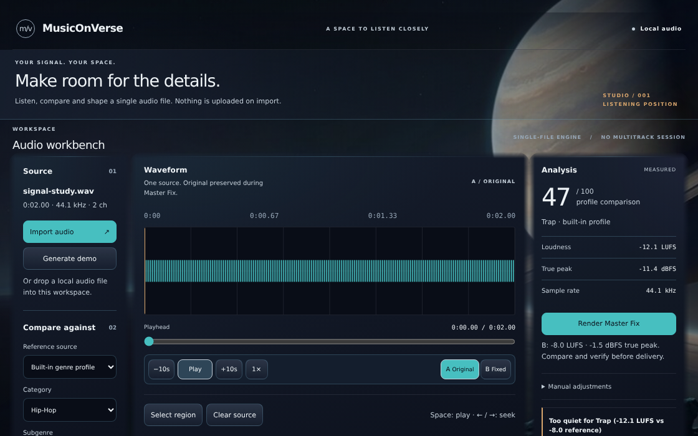
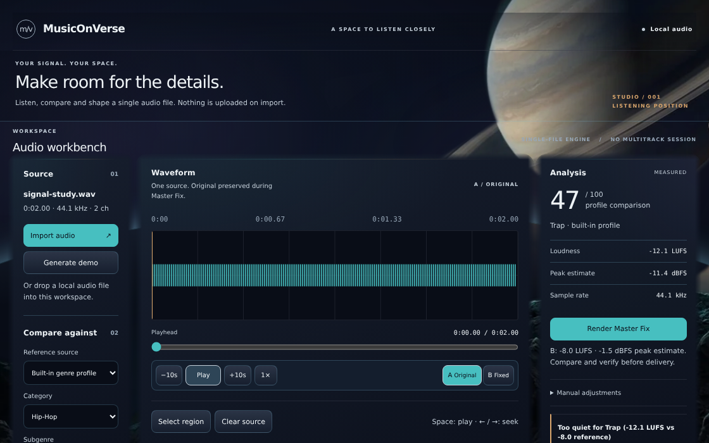

# Immersive workbench integration — 17 October 2026

## Decision and scope

**The existing single-source workbench now has an integrated, functionally verified layered cosmic environment and real graphical region editing. It is ready for scoped UI review/merge, not a full-DAW, complete-reference-vision or release approval.** No merge was performed as part of this delivery.

Branch: `arena/14df8ffa-onverse`, [PR4](https://github.com/The-Mhood/onverse/pull/4). Implementation parent: **bccebbeb4dee884f0b179319bd569ad36a423c80**. Resolve the delivery commit with `git log -1 --format=%H -- docs/engineering/UI_IMMERSION_20261017.md`; publication readback pins its exact SHA in the PR handoff. [PR8](https://github.com/The-Mhood/onverse/pull/8) was independently re-read as OPEN at **295e0d31716ceb9d8e7cd978381b46450ceb73ea** and remains unmerged. GitHub reported both PRs mergeable, with **zero check runs**; that is not CI success.

This work supersedes the old presentation hold, but preserves the verified audio/controller implementation. It does not pretend that a single waveform is a multitrack arrangement, or expose disconnected mixer/plugin/library/SYLUNE controls.

## Actual inspection and reference map

Inspected the current source and history, actual baseline production captures, and all thirteen numbered original-derived reference previews. All sixteen original reference-pack blobs were freshly checked against their recorded byte counts and SHA-256 at **900f07330f463d26bde0cc1d4bd731945c4fffec**, not inferred from thumbnails or filenames. See the immutable [source manifest](../design/REFERENCE_PACK_SOURCE.json), [verification](evidence/ui-immersion-20261017/verification.json), and original implementation guide at that reference commit. References are concepts, not feature acceptance evidence.

| Ref | Intended role | Actual implementation and remaining gap |
|---|---|---|
| 01 — cosmic moodboard | Physical scale, mineral material, restrained cosmic light | **Partial.** Dark mineral surfaces, warm/cool environmental spill, celestial/near-ground separation. No physically simulated volumetric light, material scattering or camera traversal. |
| 02 — universe opening | Grounded first-person cosmic space | **Partial, materially improved.** Fixed overscanned environment, independent celestial/rock geometry, curved horizon and autonomous depth motion. No separate exploration/opening sequence. |
| 03 — studio arrival | Transition from environment to focused creation | **Partial.** Shared environment and real state-driven work-surface transitions; not a cinematic travel/arrival scene. |
| 04 — immersive studio | Environmental framing around production work | **Partial.** Continuous scenery frames a stable, readable workbench. No cockpit, ship or alien framing; no full spatial arrangement console. |
| 05 — arrangement | Professional ruler, aligned regions, headers and navigation | **Partial.** Real single-source waveform, time ruler, seeking, playhead, A/B and editable/exportable selection. Multiple tracks/clips, arrangement lanes, fades and session routing are **missing**, not drawn as fake controls. |
| 06 — mixer | Channel organization, routing and metering | **Missing as a functional view.** Analysis/manual processing are not a mixer. No channel-strip or routing claims. |
| 07 — plugin | Precise processing controls | **Partial design correspondence only.** Existing numeric manual adjustments render real audio; no plugin host, plugin windows or plugin execution. |
| 08 — SYLUNE | Abstract attentive musical assistant; suggestion/review/action distinction | **Missing.** No SYLUNE execution, portrait, chat placeholder or suggestion falsely presented as an applied action. |
| 09 — detailed editing | Precise region and numeric editing | **Implemented for this single-source scope; partial against the broader reference.** Real IN/OUT drag handles, keyboard control, synchronized exact inputs/ARIA, region audition/export and destructive working-copy crop. No multitrack editing, automation, fades, project undo or history UI. |
| 10 — sound library | Discovery and readable media metadata | **Missing as a library.** Local import/source metadata and reference selection are functional, not a browsable media database. |
| 11 — alternative studio | Consistent workspace in another celestial setting | **Partial.** One shared material/control system, one grounded environment. No alternate-environment switcher. |
| 12 — numbered overview | Navigation across the reference concepts | **Reference only.** Does not imply thirteen implemented screens. |
| 13 — shared language | Mineral foundations, disciplined accents, neutral type, reliable states | **Integrated across the existing workbench and limits panel.** Shared tokens, environmental light, feathered material edges, sharp data/controls, explicit unavailable states and focus treatment. Full reference-wide feature coverage is not complete. |

### Implemented and exercised product surfaces

- Truthful empty/import state; actual 16-second synth demo; local decoding and automatic analysis.
- Source/reference controls, uploaded-reference comparison and built-in category/subgenre profile selection. Profiles remain explicitly heuristic. Supported external-provider lookup is **not** verified by the synthetic local replay; unsupported URLs are rejected without external requests.
- Single-source waveform editor, ruler/playhead, actual playback/pause/seek/rate, original/fixed A/B.
- Region selection with real drag/keyboard boundaries, precise IN/OUT inputs, region playback/export and working-copy crop. Cropping B still measures before publication and preserves last-valid B on failure.
- Actual Master Fix, manual render offsets/reset, analysis findings, WAV/MP3 download and report download. Browser-supported recorder formats depend on capability; they are not universal codec promises.
- Limits dialog, manual-adjustment disclosure, status/progress/error states and wired update UI. Real provider/update-service/native installation execution is **unverified**, not established by screenshots.
- No separate arrangement/mixer/plugin/library/SYLUNE/project-management application is integrated. Held session/storage/IPC work remains held; it was not silently activated through this UI change.

## Is the environment actually continuously drifting?

### Before

The baseline was **not static**, but its principal planet, ground and horizon were flattened into one JPG. A group drift and three gradient veils moved: **four animation layers**, no real pointer-depth adapter. That was limited atmosphere over a moving image, not independently moving celestial and near-ground content.

### After

The runtime no longer uses the whole JPG as its background. Four separate planes provide distant procedural stars, alpha-isolated celestial bodies/rings, curved horizon geometry and alpha-isolated near rocks. Three independent atmospheric/light fields and the existing group drift bring the measured total to **eight distinct animation names**, all actually advancing at both requested viewports. New geometric periods are **337 / 263 / 193 / 137 seconds**, with staggered negative phases, smooth alternate endpoints and restrained differential motion.

Actual mouse/pen PointerEvents drive bounded, smoothed offsets (maximum base response ±10px horizontal/±7px vertical), with different depth factors **−0.07 / −0.24 / −0.5 / −1.15**. Functional controls never move. Actual touch input does not drive decorative parallax. Device type comes from the event, not an unreliable primary-pointer media query—important for touch-primary hybrids and this pointer-less headless host. There is **no browser media-API shim** in the final proof.

**This is a genuinely continuous layered 2.5D presentation, not one moving wallpaper or a particle-only effect. It is not a navigable, volumetric or physically lit 3D universe.** Lighting is authored gradient/opacity spill; it does not ray-trace or relight the planet surface. Motion is intentionally gentle, so a still screenshot understates the change. Continuous motion and differential depth are established by live animation-time/computed-matrix/input assertions, not by a still image alone.

Real playback advances while celestial animation time advances and the depth planes remain running. Motion also continues behind the open limits panel. Button/modal interactions neutralize pointer offsets without stopping autonomous drift. Reduced motion disables scene/panel animation and neutralizes offsets; changing the preference back resumes without remounting the audio application. Pagehide invokes the real host disposal path, removes adapter listeners/RAF and pauses all eight layers. Hidden-document reset/resume is additionally unit-verified; this is not proof of native OS background/quit behavior.

### Materials, editing and implementation boundaries

- Feathered **material pseudo-elements only**, with slightly broader inset falloff, shared restrained cool/warm rim and quieter introduction framing. No waveform/type/control blur or mask; no animated filters.
- Desktop inter-surface spacing is 18px/22px; responsive workbench columns and existing density remain. Narrow desktop views intentionally scroll vertically rather than concealing controls or shrinking everything to fit.
- Real 30px region-handle targets use pointer capture and the existing `setCrop` operation. Arrows move 0.05s, Shift+arrows 0.5s, Home/End use existing bounds. IN is at the top, OUT at the bottom so very narrow selections do not stack their hit targets. A second simultaneous pointer cannot take over the active gesture. Capture/listeners are cleaned up on disposal.
- Corrected the misleading visible “True peak” label to **“Peak estimate”**, including B results, and explicitly described loudness as ungated. No meter algorithm or audio tolerance was changed to support these labels.
- Added a presentation-only adapter; no audio/state authority, second store, DSP, backend/model, IPC/storage/history/undo/security or dependency-contract change. All seventeen tracked protected runtime/configuration paths checked in the evidence remain byte-identical to the parent.
- Two alpha WebP assets total **70,276 bytes**, reproducibly masked from the unchanged local source JPG (SHA-256 `e9f087201c2f061a8154bfd818fb1348da849a43dc835b2d150628d627e33fd4`). No external imagery/provider was introduced. The derivation script is included; Pillow is an external proof-only tool, not an application dependency.

## Before / after evidence

These are actual production-browser captures of the same synthetic source, not new concept renders. Full reports include empty, region, fixed, manual, loaded, open-panel, reduced-motion, cropped and preserved-error states plus full-page captures. Motion phase naturally differs between captures.

**1120×700 — before**

**1120×700 — after**

**1480×920 — before / after**

- [Before loaded](evidence/ui-immersion-20261017/before-loaded-1480x920.png)
- [After loaded](evidence/ui-immersion-20261017/after-loaded-1480x920.png)
- [Actual region editing, 1120×700](evidence/ui-immersion-20261017/after-region-editing-1120x700.png)
- [Actual open limits panel, 1480×920](evidence/ui-immersion-20261017/after-panel-open-1480x920.png)

Visually reviewed actual captures at both sizes, including region controls and open-panel framing. No broken asset or horizontal overflow/clipped control was detected. The editor remains deliberately flat and precise within the scene: this does **not** reproduce the scale, full DAW breadth or cinematic travel of the broader concepts. Significant future feature views must share this system rather than arrive as disconnected glowing cards.

## Verification — what actually ran

[Machine verification and evidence hashes](evidence/ui-immersion-20261017/verification.json) · [Baseline browser report](evidence/ui-immersion-20261017/before-report.json) · [After browser report](evidence/ui-immersion-20261017/after-report.json)

| Check | Actual result / limitation |
|---|---|
| Clean published-source review view, final UI source | **381/381 PASS** |
| Published source plus 68 unchanged held source/docs, excluding retired icons from the review copy only | **571/571 PASS** |
| Actual dirty root | **570/571**, sole known icon-retirement failure: `build/icon.icns should be absent`. Icons remain present and untouched; no test weakened. |
| Focused loudness/analyzer/recorder/encoder/controller/environment set | **251/251 PASS**, zero skip/TODO; exact command in machine summary. |
| New environment adapter unit cases | **10/10 PASS**: idle/settling/bounds, invalid/touch/unknown input, secondary precise input, controls/modal neutralization, reduced motion, visibility, focus/blur and complete idempotent disposal. |
| Sanity and production build | **PASS**. Final HTML **381,509 bytes**, SHA-256 `bc74430977793caf2b9cfc3e365c6d986ee678fc9da9a9c34c8f7aca4132eb52`, versus baseline 423,837 bytes. No chunk-size warning. |
| Baseline actual browser | **22 groups PASS**, 13 downloads, 32 actual PNGs. |
| Final actual browser | **25 groups PASS**, 13 downloads, **36 actual PNGs**; 1120×700 / 1480×920, actual ESM/build/file-origin entry, real audio and editing, eight-layer animation/parallax, touch, modal transitions/focus/Escape, reduced motion/resume and disposal. |
| Audio preservation | A WAV byte-identical through B render/manual processing/B crop; MP3 **81,502 bytes**, unchanged SHA-256 `9ed582c9d48a11bff0adc5cf4c4605ad08e1db2cec00921883a9c2e9d6886100`. Decoder errors preserve current audio. |
| Actual Chromium OfflineAudioContext regression probe | **12 cases PASS**, unchanged **1e−6** tolerance, max gain error `7.436e−9`, max target error `2.832e−7`; finite/immutable PCM, preserved polarity and geometry. This is browser-native Web Audio, not native Mac qualification. |
| Cleanup/errors | **10/10** main/probe realtime contexts close, separate file-origin **1/1** closes; zero unexpected page errors/failed responses/blocked requests. Expected invalid-decode console error remains recorded. Private proof runtime cleaned in `finally`. |
| Dependency audit | Full **13: 4 high / 9 moderate**; production-only **0**. No advisories remediated or risk-accepted by this UI change; not security certification. |

`node --test` also discovers `scripts/test-analyze.mjs` as one additional test. Thus tests-only equivalents are **380 / 570 / 569-of-570**, rather than an unexplained extra regression/test relative to prior explicit tests-only totals.

### Performance honesty

The predeclared five-second headless budget is p95 frame interval ≤50ms and mean ≥30fps at both sizes. Final measured results: **1120×700: 49.24fps mean, 33.4ms p95, 233.35ms maximum, six intervals >50ms**; **1480×920: 57.21fps mean, 16.8ms p95, 50ms maximum, zero intervals >50ms**. Both pass the declared budget, but the smaller-view outlier is real and is not hidden by the average. This Linux CPU-raster browser is not a target-device GPU, battery, physical-input or sustained Mac performance qualification. No claim of flawless 60fps.

Earlier failed proof attempts are retained in local logs: the host reported no fine pointer; ineffective Blink/CDP media overrides were abandoned, not left as a fake proof. The production adapter instead identifies actual mouse/pen/touch events. A later reduced-motion check exposed CSS optimizer folding of `transform:none` plus `translate:none` into an identity matrix; the implementation now neutralizes scene-offset variables in CSS and retains a genuine `transform:none`. The original browser assertions were kept, and the final replay passes without accepting moving/identity transforms in their place.

## Preservation, collaboration and remaining critical path

- Began with **204 inventoried original files**. **198 remain SHA-identical**; the only six changed originals are the explicitly authorized environment/tokens/host CSS/host JS/browser validator/static UI test. No missing or unexpected changed originals. All 68 held files, eight dirty held documents and twelve untracked original icons were preserved. No reset/clean/stash/force push, branch switch, wholesale PR8 replacement or icon deletion.
- Direct scoped handoff to P: [PR8 comment 6226720033](https://github.com/The-Mhood/onverse/pull/8#issuecomment-6226720033), requesting independent reference/editing/accessibility review while lead owned environment/host lifecycle/validation. Re-read PR8 and comments; **no new P implementation, receipt or acceptance was observed**. The lead proceeded independently, including real region handles; nothing is falsely credited as integrated P work. Publication handoff pins changed files/evidence for safe subsequent review.
- Protected audio release work remains parallel, not a reason to freeze independent UI. Original loudness assertions and six lifecycle/last-valid-B safeguards remain intact; competing PR8 runtime/distribution/packaging changes must not replace them wholesale.

### Concrete merge conditions and estimate

For the **current single-source UI**, implementation, production mounting, two-viewport interaction proof and preservation review are complete. Merge only the published tested head of PR4, with the clean-source suite, source-bound browser/build hashes and explicit known root-icon exception visible. Preserve held work outside the commit. If repository policy requires the *actual dirty checkout* to be wholly green, its artifact-ownership/icon disposition is still a separate owner-controlled gate—not a reason to delete originals or weaken the test. Zero check runs must not be called CI approval.

Remaining scoped UI critical path: **one exact-head review/acceptance pass and normal merge**, estimated **30–60 minutes of operator review/merge effort**, assuming no new design requirements or findings. It is not another speculative implementation sprint. P may independently review the captures, keyboard/touch/region cases and shared-system fidelity without editing the protected audio boundaries; inspect any exact submitted delta before integration.

**The full reference vision remains partial**, particularly arrangement/mixer/plugin/library/SYLUNE, alternate environments and cinematic arrival. These are real implementation projects requiring product/backend contracts, not polish that can honestly be declared done or assigned an arbitrary percentage. No defensible full-vision duration is established by this single-source work.

**Release remains gated** by standards-grade loudness/true-peak/surround/gain-policy qualification, physical listening, supported Mac/Electron launch and packaging/storage/recovery/update tests, signing/notarization/Gatekeeper and all thirteen security advisories (remediation or explicit documented risk acceptance). Linux/browser proof is not a substitute, and this work does not assign an unsupported release date.
