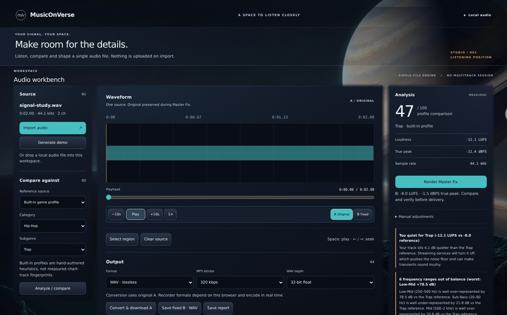
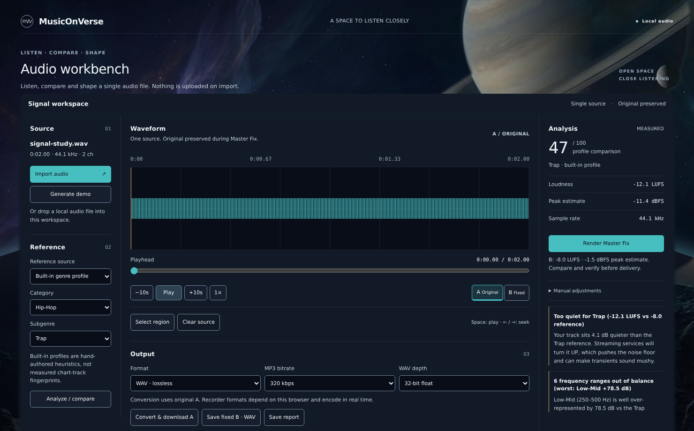

# Independent visual acceptance and corrective integration — 17 October 2026

## Disposition: review changed the incoming verdict

**P’s published implementation and the incoming f32fa93 captures do not pass the explicit visual review as delivered.** A passing workflow harness and eight moving layers were insufficient evidence of natural visual integration. The earlier f32fa93 “scoped review/merge” disposition must not be read as complete visual acceptance.

I continued implementation rather than stopping at that finding. **The corrected existing single-source studio now passes the bounded workbench composition, atmosphere/precision separation, readability, input and motion criteria below.** This is a corrective UI integration on `arena/14df8ffa-onverse`, parent **f32fa931e81c4a6949eb72c8f4fc37dd09a926be**, not a blanket merge of PR8. The full reference vision—including cinematic exploration/travel, alternate environments and full DAW feature views—is still incomplete and is not approved by this report.

[Machine evidence / preservation](evidence/visual-acceptance-20261017/verification.json) · [Fresh P production-browser replay](evidence/visual-acceptance-20261017/p-browser.json) · [Corrected production-browser replay](evidence/visual-acceptance-20261017/corrected-browser.json)

## What P actually delivered, independently retrieved

Fresh fetch/API readback identifies [PR8](https://github.com/The-Mhood/onverse/pull/8) as OPEN at **295e0d31716ceb9d8e7cd978381b46450ceb73ea**, branch `arena/31c3346b-onverse`. No newer published P implementation or acknowledgement was observed. That does not establish whether private, unpushed work exists.

P supplied the original reset/presentation foundation: semantic palette/tokens, presentation primitives, authored grounded horizon art and independent atmospheric drift. The six presentation paths in `7e105a0` cover README/palette provenance, environment CSS, presentation example markup, tokens and workbench primitives. Their useful design foundation was already integrated into the delivery ancestry; it is not a new contribution arriving in this review. PR8 also contains competing application/encoder/build changes that are **not** safe to accept wholesale.

### Fresh proof, not P’s summary

- Archived **exact 295e0d3**, used the existing locked dependencies, built it, and independently ran its production-browser workflow harness. The **only harness adaptation** was port4173→4174 in the isolated copy; inverse replacement is byte-identical to the published harness. Assertions were not removed or relaxed.
- **22 groups PASS, 13 downloads, 32 actual PNGs**, including freshly captured loaded states at both requested sizes. This confirms real available workflows, not visual acceptance or release qualification. P’s own harness is not equivalent to the stronger current delivery regression suite.
- Ran the **unchanged delivery controller test file** against P’s source in that isolated archive: **17/23 PASS, six FAIL**, zero skip/TODO. Failures reproduce late B publication after render/remeasurement, late full-analysis effects, decode publication after disposal, failed B-crop replacing last-valid B, and late reference publication. These are inherited controller paths already fixed on the verified delivery side—not new defects invented by this review. [Exact transcript](evidence/visual-acceptance-20261017/p-protected-regressions.txt).
- Therefore **do not merge PR8’s runtime over the protected delivery implementation**. No P branch was switched to, rewritten, pushed or merged.

## Direct comparison with the actual original references

The requested `docs/design/musiconverse-visual-reference-pack/` lives at source commit **900f07330f463d26bde0cc1d4bd731945c4fffec**, not as a directory checked out at the delivery head. I read the actual Git blobs, rechecked **all sixteen original files** against byte counts/SHA-256, and visually reopened original-derived images **01,02,03,11,13**. The comparison is not based on P’s prose or only reference filenames. [Original verification](evidence/visual-acceptance-20261017/reference-verification.json); [source manifest](../design/REFERENCE_PACK_SOURCE.json).

Reference13 explicitly separates **atmosphere and precision**: matte mineral surfaces, neutral UI type and tabular values, stable contrast, consistent grid, restrained functional accents, crisp controls and bloom reserved for environmental light. References01/03/11 supply celestial scale, atmospheric dust/shadow/light and the feeling of an environment surrounding the work. Reference02 supplies an environment/workspace relationship, not permission to fabricate the depicted multitrack engine.

### Major incoming visual failures

1. **Three independently feathered cards still read as a dashboard placed over a picture.** Bright seams and broad diffuse edges competed with the waveform rather than joining the studio into one work surface.
2. **The introduction and duplicate workbench headings consumed attention without adding working context.** Oversized score/uppercase framing further competed with the editor.
3. **The sky was too empty/flat compared with01/03/11.** Four or eight advancing animation names do not by themselves supply convincing atmospheric structure or physical scale.
4. **Celestial cover/crop and bright near-ground contrast were poorly controlled around the functional surfaces.** The planet’s relation to card gaps amplified the pasted-on effect.
5. **Dense labels/control boundaries needed clearer hierarchy.** Build success and absence of horizontal overflow were not enough to establish engineering-grade reading or selection/focus quality.

### Corrective implementation and actual acceptance

| Criterion | What changed and what was independently verified | Verdict for the real current studio |
|---|---|---|
| 13: one world, two layers | Source, editor and inspector are now rails within **one opaque matte workplane**. Zero column gap; subtle shared dividers. Individual card-material/glow pseudo-elements are disabled. Only the workplane’s outside material feathers. Browser confirms workplane alpha1, transparent child rails and no independent card pseudo-materials. | **PASS** |
| 13: precision, typography and states | Essential labels/time values are generally11px or larger; main headings and score are restrained. The eight canonical hue anchors remain unchanged. Functional borders have their own neutral token. Selection retains a distinct bottom-edge shape plus accessible pressed state; focus remains separate. Enabled controls were measured at both viewports: text≥4.5:1 and essential boundary≥3:1. Disabled controls are exempt; this is not a whole-app WCAG certification. | **PASS for measured controls and visually reviewed hierarchy** |
| 01/03/11: atmospheric depth and scale | Added an original local, AI-generated distant-nebula plate with structured indigo/violet/teal dust and restrained amber. It is **only the far field**, not a complete studio/planet image. Celestial/ring/moon and near-rock planes remain separate; quieter celestial/ground opacity and width-controlled framing reduce cutout/card-gap artifacts. Actual empty/loaded captures show a grounded environment rather than blank gradients. | **PASS as restrained screen-based atmosphere; not volumetric simulation** |
| 02/13: workbench naturally in that world | A continuous matte plane is visually dominant; scenery stays above and around it instead of bleeding into information. Simplified title/context, quieter header, clear Source/Reference/Output grouping. At1480×920 all loaded output actions now fit: measured bottom **908.625px**. At1120×700 vertical scrolling remains intentional, not hidden/clipped functionality. | **PASS for the current single-source workbench** |
| Continuously drifting space, not particles alone | Existing **eight distinct scene/group/light animations** advance at both sizes; differential pointer depth moves scenery but not the transport. Actual playback advances while celestial animation time advances; open panels do not stop the world. Touch is ignored by decorative parallax. Reduced motion stops/resumes, and pagehide disposes the actual adapter. | **PASS for layered2.5D behavior**, not a navigable3D universe |
| Readability with open panels/real editing | Independently viewed loaded, empty, real region-selection and open-modal captures. Numeric values/waveforms stay sharp, no data blur/mask, no broken asset or horizontal overflow. Keyboard/pointer handles, modal focus/Escape and actual audio/export workflows pass. | **PASS at1120×700 and1480×920** |
| Long-session/device performance | Same predeclared headless budget retained: mean≥30fps, p95≤50ms. Both sizes pass after the specific regression below was fixed. Real CPU-raster long-frame outliers remain disclosed. | **Limited Linux proof; sustained physical-GPU/native qualification unverified** |

**Independent visual judgment:** the corrected composition reads as a single focused listening/editing studio in the same celestial setting, rather than three glowing dashboard cards floating over wallpaper. The stronger cloud structure, quieter planet/ground and shared opaque workplane materially improve immersion without turning controls into scenery. This judgment comes from actual captures, supplemented by live input/animation tests—not from animation counts alone or a claim of pixel-identical reference reproduction.

### What is deliberately not claimed or still not built

- This remains a **2.5D screen presentation**. Illustrated atmospheric depth/light is not real volumetric scattering, ray tracing,360° spatial rendering or free camera navigation.
- Empty→loaded environmental framing now follows the **existing authoritative buffer**; it introduces no new product/session store. A separate cinematic exploration/flight/arrival sequence matching the full03 concept is **not built**.
- One world is supplied;11-inspired atmosphere is not an alternate-environment selection feature.
- Multitrack arrangement/mixer/routing/plugins/library/SYLUNE, project persistence/history/undo and their reference-wide views remain **missing or partial**, not inert controls disguised as working features.
- Therefore **full-reference/product visual completion is still not passed**. There is no known remaining major compositional blocker for integrating the corrected **currently functioning single-source studio**; broader missing feature/sequence work is not relabelled “polish” or assigned a fictional completion percentage.

## Fresh actual visual evidence

All images below are production-browser captures using the same synthetic source, not generated UI concept renders. The new far-field artwork is generated; the interface, waveform and states are the actual running app.

**P,295e0d3 — fresh1480×920**

**Corrected integration — fresh1480×920**

- [P loaded1120×700](evidence/visual-acceptance-20261017/p-loaded-1120x700.png)
- [Corrected loaded1120×700](evidence/visual-acceptance-20261017/corrected-loaded-1120x700.png)
- [Corrected empty1480×920](evidence/visual-acceptance-20261017/corrected-empty-1480x920.png)
- [Actual open panel1120×700](evidence/visual-acceptance-20261017/corrected-panel-open-1120x700.png)
- [Actual region editing1120×700](evidence/visual-acceptance-20261017/corrected-region-editing-1120x700.png)

### A real performance failure was fixed, not waived

The first nebula implementation placed a full-field image in a translucent animated pseudo-layer. It looked better in still captures but **failed** the unchanged CPU-raster budget: roughly19fps with66–83ms p95. Caching the workplane alone did not fix it. A no-nebula diagnostic isolated the cost. Moving the nebula into the **opaque distant-field group** restored throughput, while celestial/horizon/near-ground/light fields remain independently animated. No reduced detail flag, disabled scene animation or relaxed threshold was used to obtain the final pass.

Final five-second samples: **1120×700:53.03fps mean,33.3ms p95,266.57ms maximum, two intervals>50ms**. **1480×920:50.43fps mean,33.4ms p95,333.4ms maximum, three intervals>50ms**. Those outliers are real: this is not a flawless60fps, sustained hardware, power/battery or supported Mac performance claim. Raw failed/diagnostic logs remain locally under `/home/user/reviews/visual-acceptance-20261017/`.

## Independent functional, source and preservation verification

| Check | Result |
|---|---|
| Corrected clean published-source review | **383/383 PASS**, zero fail/skip/TODO |
| Published source plus68 unchanged held source/docs, review copy without original untracked icons | **573/573 PASS** |
| Actual dirty root, no exclusions/deletions | **572/573**, sole existing `build/icon.icns should be absent` assertion; original icons remain untouched |
| Corrected production browser | **26 groups PASS /13 downloads /36 actual PNGs**, both target viewports; zero unexpected page errors/failed responses/blocked requests |
| Real workflows | Import/demo/reference/analyze/playback/pause/seek/rate/A–B; real region drag/keyboard/export/crop; MasterFix/manual render/reset; WAV/MP3/report; decoder-error preservation; file-origin boot/export; reduced motion/panels/disposal |
| Audio invariants |12 actual Chromium OfflineAudioContext cases, unchanged1e−6 tolerance; A PCM/export preserved, MP3 SHA remains `9ed582c9d48a11bff0adc5cf4c4605ad08e1db2cec00921883a9c2e9d6886100`;10/10 realtime contexts and separate file-origin1/1 close |
| Build | PASS; self-contained HTML **459,896B**, SHA256 **d808552e5df5977e49cf50d741a307cdefbad997338d9ee0765345cd90193212**. No chunk warning. Larger than prior381,509B because of the new53KB local atmospheric plate plus scoped CSS; no size-saving claim. |
| New visual tests | Two additional static integration tests plus live opaque-plane/no-card-material/contrast/output-fit assertions. No protected audio test body/tolerance weakened. |
| Preservation | **229 original files** inventoried: **223 SHA-identical**, only six authorized UI/validator/test originals modified; no missing/unexpected changes. All8 held tracked docs,60 held untracked source/docs and12 original icons unchanged. |
| Protected scope | All checked tracked audio/application/native/build/dependency contracts remain byte-identical to parent. No framework/dependency, state-store, encoder, DSP, packaging or security change. |
| Audit | Fresh full audit **13:4 high/9 moderate**, production-only0; none remediated or risk-accepted by this change |

`node --test` discovers the sanity script as one extra test. Explicit tests-only equivalents are382/572/571-of572, not an unexplained test-count discrepancy. Committed transcripts trim trailing whitespace only; raw-log hashes and original unchanged local logs are retained. No CI result is inferred from local proof.

## Direct coordination and exact integration distance

Direct P handoff: [PR8 comment6227400933](https://github.com/The-Mhood/onverse/pull/8#issuecomment-6227400933). It gives the concrete reference/capture failures, requests independent reference13/material/accessibility critique or an exact newer head, reserves lead’s active host/environment files and prohibits overwriting verified audio. The lead continued the corrections independently. Publication handoff pins the resulting code/captures/tests for further safe review. **A posted comment is not receipt, execution or P acceptance**; none was observed or credited.

The new corrective slice is integrated into the **real delivery renderer**, not a separate mockup. Its commit is a direct child of f32fa93 on fixed branch `arena/14df8ffa-onverse` / [PR4](https://github.com/The-Mhood/onverse/pull/4); exact full SHA is pinned in the publication/readback handoff. No main merge or whole PR8 merge is asserted.

**Distance to clean scoped UI integration:** no pending UI cherry-pick or known major current-workbench visual gap remains after this correction and replay. The clean published source passes; the remaining repository operation to main is **one exact-head normal PR4 merge/review**, not another speculative presentation sprint. Actual checkout cleanliness is different:8 held tracked docs and72 original untracked files deliberately remain, and the root icon-retirement assertion remains red. Do not “clean” those away to manufacture green. If policy demands a wholly green actual dirty root, resolving original icon ownership is an additional explicit gate; the committed tree itself excludes those retired artifacts.

Broader cinematic-arrival/alternate-world/full-DAW work remains real implementation work with unsettled scope/contracts; no defensible full-vision deadline is established here. Safe parallel P work is independent capture/fidelity/accessibility review or a separately scoped additive proposal, with exact-head reconciliation before integration—not another overlapping renderer or replacement audio implementation.

**Separate audio and release blockers:** P’s six reproduced lifecycle/last-valid-B failures block wholesale PR8 runtime integration; they do not reappear in the corrected protected delivery suite. Original loudness regression assertions remain passing without weakening, but standards-grade loudness/true-peak/surround/gain policy, physical listening, supported Mac/Electron packaging/launch/storage/recovery/update, signing/notarization/Gatekeeper and all13 security advisories remain release gates. Browser/Linux/native-WebAudio proof is not listening, native Mac qualification, security certification or product release approval.
